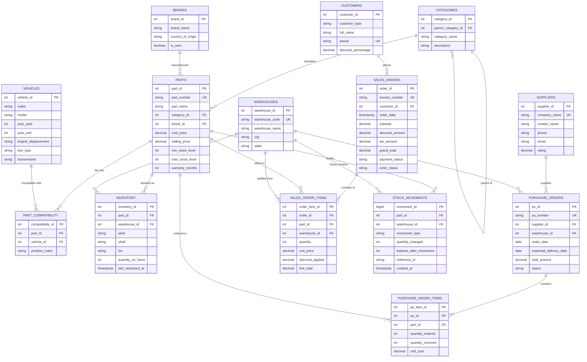

# Entity-Relationship (ER) Diagram
## Vehicle Spare Parts and Inventory Management System (VSP-IMS)

### 1. Conceptual ER Diagram (Mermaid)

---

### 2. Entity Relationships & Cardinality Description

| Relationship | Entities Involved | Cardinality | Business Rule |
|---|---|---|---|
| **Category Hierarchy** | `categories` $\rightarrow$ `categories` | $1 : N$ (Optional) | A parent category can have multiple subcategories (e.g., Braking $\rightarrow$ Brake Rotors). |
| **Catalog Classification** | `categories` $\rightarrow$ `parts` | $1 : N$ (Mandatory) | Every part belongs to exactly one category; a category groups multiple parts. |
| **Brand Manufacturing** | `brands` $\rightarrow$ `parts` | $1 : N$ (Mandatory) | Every part is produced by a manufacturer / brand (Bosch, Brembo, etc.). |
| **Vehicle Fitment** | `parts` $\leftrightarrow$ `vehicles` | $M : N$ via `part_compatibility` | A spare part can fit multiple vehicles (e.g. spark plug fits Corolla and Civic); a vehicle requires many parts. |
| **Multi-Location Inventory** | `parts` $\leftrightarrow$ `warehouses` | $M : N$ via `inventory` | A part can be stored across multiple warehouses with bin/shelf coordinates. |
| **Procurement PO** | `suppliers` $\rightarrow$ `purchase_orders` | $1 : N$ | A supplier receives multiple purchase orders for stock replenishment. |
| **PO Line Items** | `purchase_orders` $\rightarrow$ `purchase_order_items` | $1 : N$ (Mandatory) | A PO consists of multiple items ordered. |
| **Customer Orders** | `customers` $\rightarrow$ `sales_orders` | $1 : N$ | Retail buyers, workshops, or fleet clients place multiple sales orders. |
| **Invoice Line Items** | `sales_orders` $\rightarrow$ `sales_order_items` | $1 : N$ (Mandatory) | An invoice contains one or more line items dispatched from specific warehouses. |
| **Inventory Audit Trail** | `parts` / `warehouses` $\rightarrow$ `stock_movements` | $1 : N$ | Immutable audit ledger logging every stock increase, decrease, or internal transfer. |
